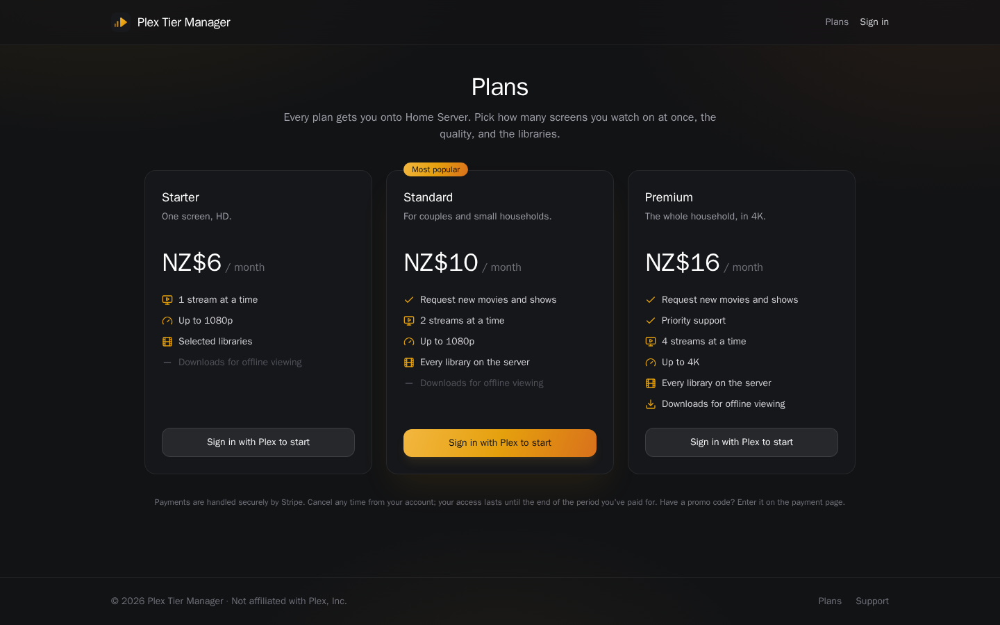
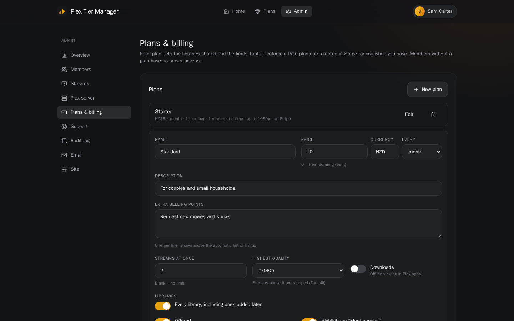
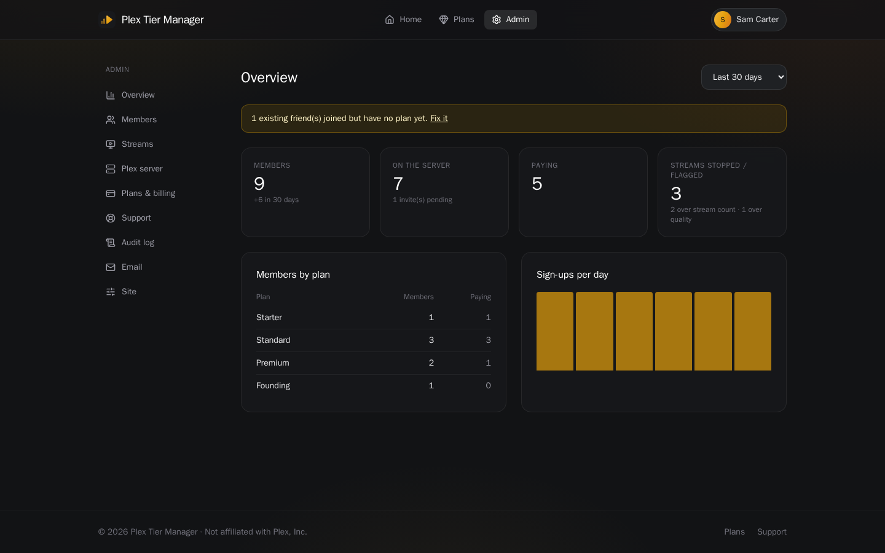
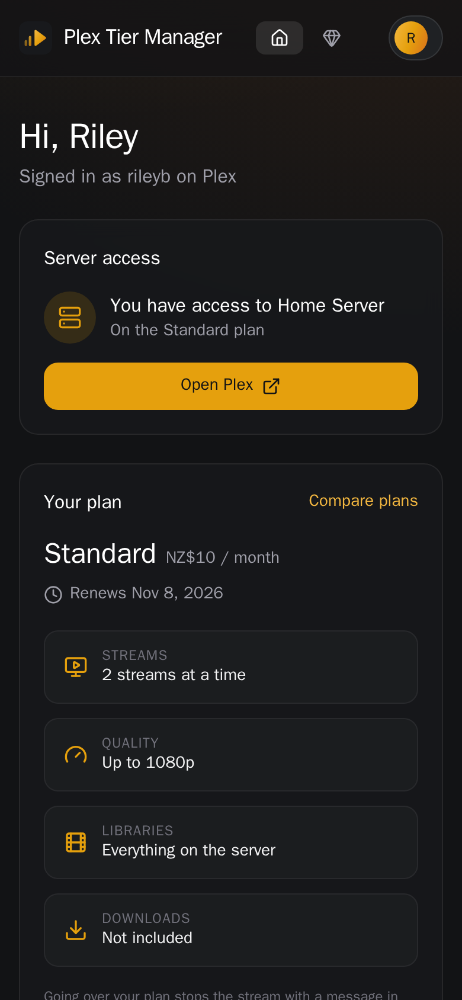
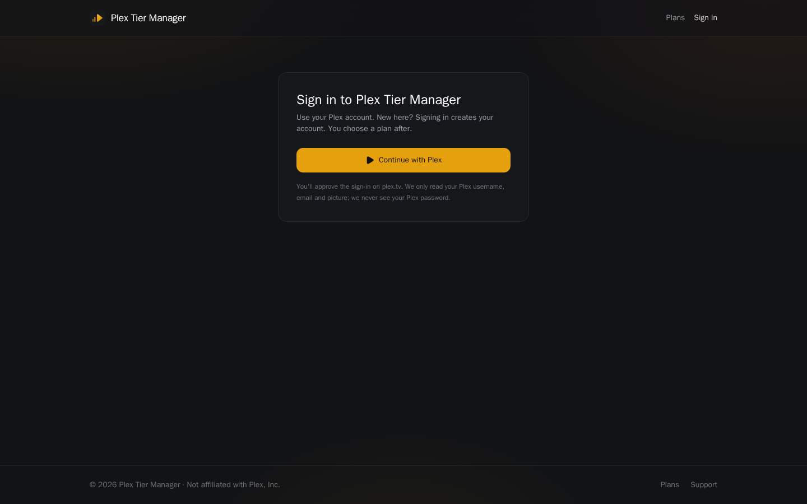

# Plex Tier Manager

Paid plans for access to your Plex server. People sign in with Plex, choose a plan, pay through Stripe, and are invited
to the server. Each plan decides which libraries are shared, whether downloads are allowed, how many streams can play at
once and the highest quality. Tautulli reports what's playing, and streams over a plan's limits are stopped.

Not affiliated with Plex, Inc. You're responsible for complying with Plex's terms of service, your payment provider's
rules, and the rights to the content you share.


## Screenshots

| | |
|---|---|
|  **Member home:** server access, plan limits, and what's new and coming |  **Plans:** streams, quality, libraries and downloads per plan |
|  **Admin, Members:** server access, plan and Plex status for everyone |  **Admin, Streams:** Tautulli setup, what's playing now, streams stopped |
|  **Admin, Plans & billing:** libraries and limits per plan, synced to Stripe |  **Admin, Overview** |

<p align="center"> &nbsp; </p>

The screenshots use demo data.

## How it works

1. **Sign in with Plex.** The plex.tv PIN flow: people approve the sign-in on plex.tv and are sent back. The site reads
   their Plex username, email and picture. Their Plex token is used once and never stored. Signing in creates an
   account but gives no server access.
2. **Choose a plan.** Stripe Checkout and the Stripe customer portal. Promotions are optional: automatic free trials and
   discounts shown on the plan cards, or codes typed on Stripe's payment page.
3. **Invite.** When a plan starts, the member is invited to the server with the plan's libraries, or their existing
   share is updated. They accept the invite in Plex and press "I've accepted it" on their home page.
4. **Limits.** When playback starts, Tautulli calls the site's webhook; a sweep also runs every minute. Each member's
   streams are compared with their plan:
   - **Too many streams:** the newest one is stopped.
   - **Quality above the plan:** that stream is stopped (for example 4K on a 1080p plan).

   Both show a message in the player, and both messages can be edited. Run in **Monitor** mode (log only) first, then
   switch to **Enforce**. The server owner and admins are never limited.
5. **Removal.** When a subscription is cancelled, ends, or lapses, access to the server is removed. A paid plan stops
   counting 3 days after its billing period ends, even if Stripe's webhook never arrives.

A check against Plex runs every 15 minutes, straight after any plan change, and on demand from the admin panel. It
keeps everyone's access in line with their plan and fixes drift.

### People already on your server

Existing friends keep their access untouched until you give them a plan. Admin → Plex server lists everyone on the
server. One click gives everyone without a plan a plan, for example a free, hidden "Founding" plan. It also creates
accounts for people who haven't signed in yet; they land on that account when they do. From then on their access
follows their plan like everyone else's. Access the site didn't grant is never removed.

### What's on the server

With Seerr connected, the member home page shows two rows, refreshed every 30 minutes:

- **New on <server>:** trending titles already in Plex, newest releases first. Seerr knows what's in Plex because it
  syncs with your libraries.
- **Coming soon:** requested titles that aren't out yet, soonest first. This includes new episodes of shows already on
  the server.

Posters can link to Seerr, to the title in Plex, or nowhere. Plex links use your server's external URL, or app.plex.tv.
Optionally, the rows also appear on the public home page, without links.

## Features

- **Members:** Plex sign-in. A home page with server access and an invite walkthrough, plan limits, and the Seerr rows.
  Billing through the Stripe portal. Signed-in devices, data export (JSON), and account deletion; deleting cancels the
  subscription and removes server access.
- **Plans:** price, libraries (or every library, including ones added later), streams at once, highest quality, and
  downloads. Paid plans are created in Stripe when saved. Free plans are given by admins.
- **Admin panel:**
  - **Overview:** members, server access, paying members, streams stopped, and sign-ups.
  - **Members:** filter by server access. Set a plan, check with Plex now, disable, or delete. Each member has a detail
    page with activity, payments and streams over their plan's limits.
  - **Streams:** Tautulli setup, the webhook URL to copy, what's playing now with a stop button, and the log of streams
    over a plan's limits.
  - **Plex server:** connect the owner account, choose the server, see the libraries, see people on the server and give
    them a plan, and connect Seerr.
  - **Plans & billing:** plans, promotions, the Stripe connection, and the payments log.
  - **Also:** the support inbox, an audit log, email (SMTP), and site settings.
- **Support:** FAQs and a contact form. Signed-in members follow their requests on the site.
- **One container.** A FastAPI backend serves the React frontend and runs the background jobs. It uses PostgreSQL
  (SQLite works for testing). Secrets (Plex owner token, Tautulli, Seerr and Stripe keys, SMTP password) are encrypted in
  the database.

## Setup

```bash
cp .env.example .env    # PUBLIC_URL, SECRET_KEY, POSTGRES_PASSWORD, BOOTSTRAP_ADMINS (your Plex username)
docker compose up -d --build
```

Run it where it can reach Tautulli (and Seerr) on your network, and where Tautulli can reach it for the webhook, for
example on the machine running Plex. Put it behind your reverse proxy for HTTPS.

`PUBLIC_URL` must be the address people use. The Plex sign-in callback is built from it, and sign-in only works when it
starts on that address: the sign-in cookie belongs to the host you start on. Other names (such as an internal one) work
for browsing.

Then, signed in as an admin:

1. **Admin → Plex server:** connect the Plex account that owns the server, and choose the server. The owner becomes an
   admin automatically.
2. **Admin → Plans & billing:** add your plans. Add a free, hidden "Founding" plan for people already on the server.
   Then add your Stripe secret key and the webhook (`<PUBLIC_URL>/api/billing/webhook`) and turn on "Sell paid plans".
   - Webhook events: `checkout.session.completed`, `checkout.session.expired`, `customer.subscription.created`,
     `customer.subscription.updated`, `customer.subscription.deleted`.
   - For the payments log, also add `invoice.paid`, `invoice.payment_failed`, `charge.refunded`,
     `charge.dispute.created` and `charge.dispute.closed`.
3. **Admin → Plex server → People on the server:** give existing friends a plan.
4. **Admin → Streams:** enter the Tautulli URL and API key. In Tautulli, add a Webhook notification agent pointing at the
   URL shown there (POST; triggers Playback Start, Playback Resume and Transcode Decision Change). Start in Monitor mode.
5. **Admin → Plex server → Seerr** (optional): the URL and API key. Choose where posters link, and whether visitors see
   the rows.

Admin from the command line: `docker exec ptm python -m app.cli make-admin <plex-username>`.

### Environment

| Variable | |
|---|---|
| `PUBLIC_URL` | The site's address, no trailing slash, e.g. `https://ptm.example.com` |
| `SECRET_KEY` | Long random string (`openssl rand -base64 48`). Signs sessions and encrypts stored secrets; don't change it. |
| `POSTGRES_PASSWORD` | Database password used by `docker-compose.yml` |
| `BOOTSTRAP_ADMINS` | Comma-separated Plex usernames or Plex account ids that become admins when they sign in (not emails, which Plex doesn't guarantee are confirmed) |
| `PTM_PORT` | Host port (default 8000) |
| `BACKGROUND_JOBS` | `false` turns off the Plex check and the Tautulli sweep (tests) |

Everything else is set in the admin panel.

## Notes

- **Download settings.** Existing friends' libraries and download setting are updated separately. For some friends,
  plex.tv refuses to change the download setting, so the site retries with Plex's older endpoint. If that's refused too,
  the libraries still count as shared, and the member shows a **Plex warning** instead of an error until a later check
  succeeds.
- **Quality limits** stop streams; Plex itself has no per-user quality cap. Members are told to pick a lower quality in
  their player. For a hard limit, keep 4K in its own library and share it only on the plans that include 4K.
- **Downloads** also need Plex Pass on the member's own Plex account.

## Development

- **Backend** (`backend/`): FastAPI, async SQLAlchemy and Alembic, python-plexapi and httpx. Migrations run on start.
  Tests: `pip install -e '.[dev]' && pytest`. Plex, Tautulli, Seerr and Stripe are faked, so nothing reaches the real
  services.
- **Frontend** (`frontend/`): React 19, Vite and Tailwind 4. `npm ci && npm run build`. The backend serves `dist/`.
- **One image:** the `Dockerfile` builds the frontend, then the backend image that serves it.
