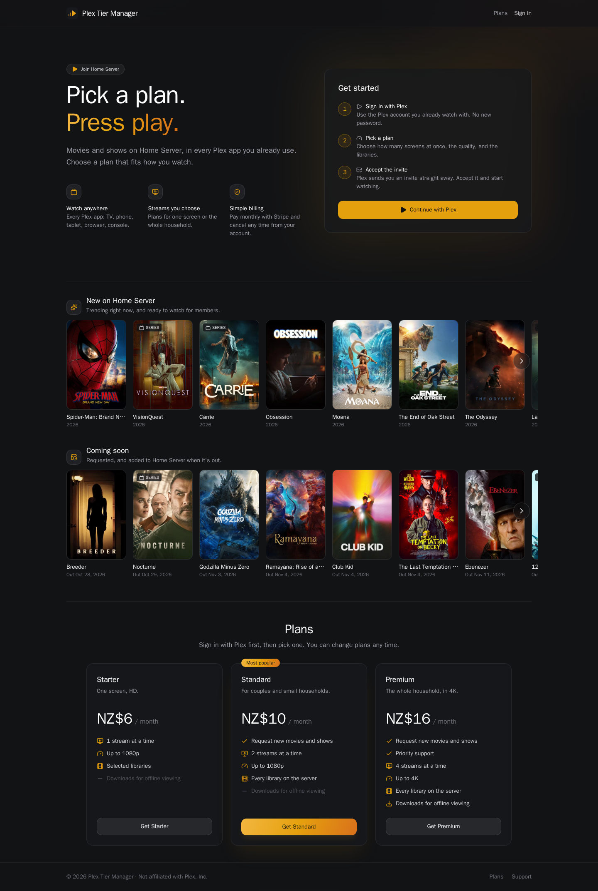
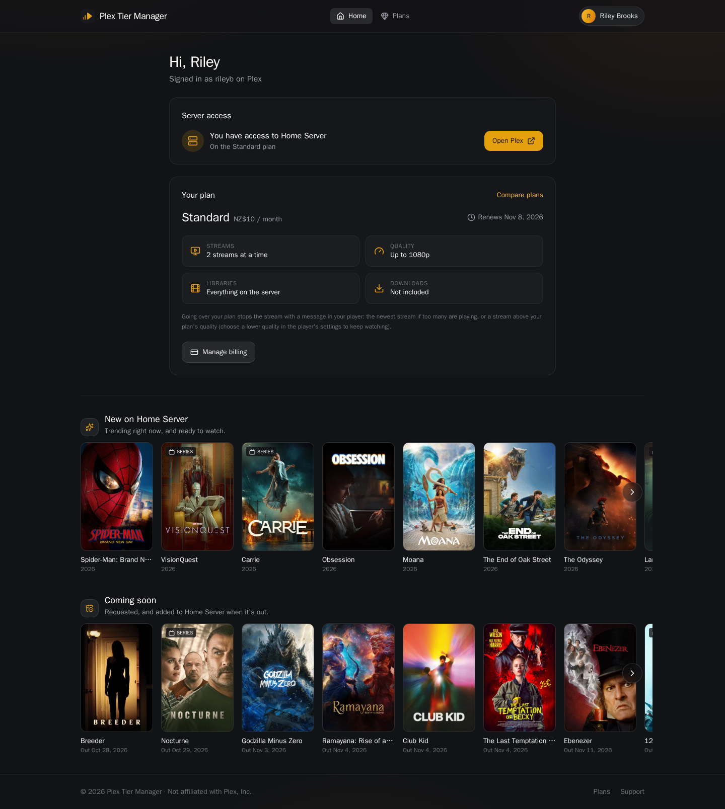
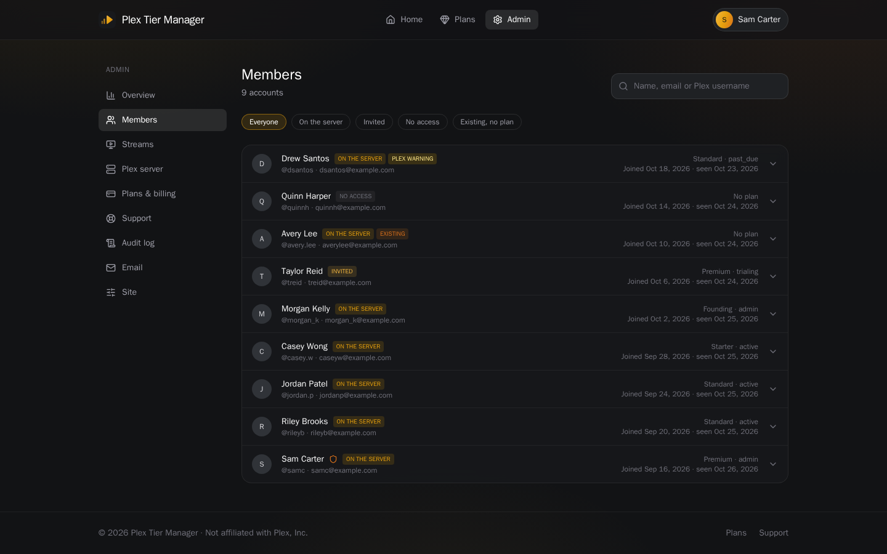
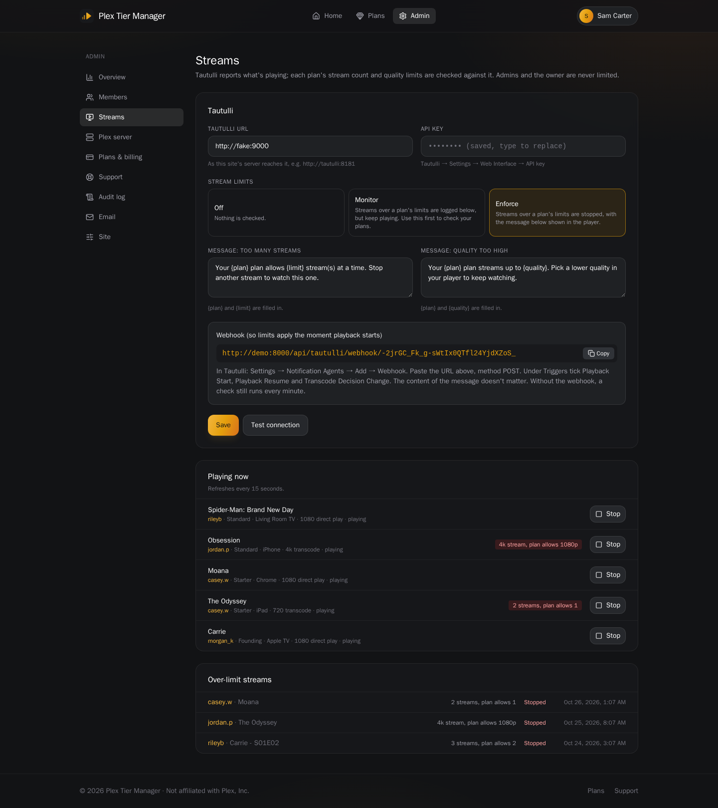

<p align="center">
  
</p>

# PTM — Plex Tier Manager

<p align="center">
  <b>Paid plans for your Plex server.</b><br>
  People sign in with Plex, pick a plan, pay with Stripe, and are invited to your server. Plans set the libraries,
  streams at once, quality and downloads, and Tautulli enforces them.
</p>


---

## Features

- **Sign in with Plex.** No new passwords. Members' Plex tokens are never stored.
- **Plans with real limits.** Each plan sets which libraries are shared, how many streams can play at once, the highest
  quality, and downloads.
- **Automatic access.** Members are invited when a plan starts, their libraries change when they switch plans, and
  they're removed when it ends. People already on your server keep their access until you give them a plan.
- **Stream limits through Tautulli.** The newest stream over a plan's count, or any stream above its quality, is
  stopped with a message in the player. Start in monitor mode (log only).
- **Stripe billing.** Checkout, the customer portal, free trials, discounts and promotion codes.
- **What's on the server.** With Seerr connected, the home page shows trending titles already in Plex, and requested
  titles that are coming soon.
- **Admin panel.** Members, live streams, Plex server, plans, support inbox, audit log and settings.

## Screenshots

| Home page | Member home |
|-----------|-------------|
|  |  |

| Members | Streams |
|---------|---------|
|  |  |

More in [`docs/screenshots`](./docs/screenshots). The screenshots use demo data.

---

## Install

You need Docker, a Plex server you own, Tautulli, Seerr (Overseerr), and (for paid plans) a Stripe account.

```bash
git clone https://github.com/Jarsky/plex-tier-manager.git
cd plex-tier-manager
cp .env.example .env      # then edit it (see below)
docker compose up -d --build
```

Edit `.env` before starting:

| Variable | Value |
|---|---|
| `PUBLIC_URL` | The address people will use, e.g. `https://ptm.example.com` (no trailing slash) |
| `SECRET_KEY` | A long random string: `openssl rand -base64 48`. Don't change it later. |
| `POSTGRES_PASSWORD` | Any strong password for the bundled database |
| `BOOTSTRAP_ADMINS` | Your Plex username, so you're an admin when you first sign in |
| `PTM_PORT` | Host port (default `8000`) |

The app listens on port 8000. Put it behind your reverse proxy for HTTPS at `PUBLIC_URL`.

Run it where it can reach Tautulli, and where Tautulli can reach it. The same machine as Plex works well.

> Always sign in at `PUBLIC_URL`. Plex sends you back to that address, so signing in from another address (such as a
> LAN IP) won't complete.

## Configure

Sign in with Plex at `PUBLIC_URL`, open **Admin**, and work through these:

1. **Plex server.** Connect the Plex account that owns the server, then choose the server.
2. **Plans & billing.** Create your plans.
   - Add a free, hidden **Founding** plan for people already on your server.
   - Add your Stripe secret key, then turn on **Sell paid plans**.
   - In Stripe, add a webhook to `PUBLIC_URL/api/billing/webhook` with these events: `checkout.session.completed`,
     `checkout.session.expired`, `customer.subscription.created`, `customer.subscription.updated` and
     `customer.subscription.deleted`. Paste its signing secret into PTM.
3. **Plex server → People on the server.** Give everyone already there the Founding plan.
4. **Streams.** Enter the Tautulli URL and API key, and choose **Monitor**.
   - In Tautulli, add a **Webhook** notification agent with the URL PTM shows. Use method POST and the triggers Playback
     Start, Playback Resume and Transcode Decision Change.
   - Switch PTM to **Enforce** once the log looks right.
5. **Plex server → Seerr** (optional). Enter the Seerr URL and API key, choose where posters link (Seerr, Plex or
   nowhere), and choose whether visitors see the rows.
6. **Email** (optional). SMTP, for support replies.

Command-line admin: `docker exec ptm python -m app.cli make-admin <plex-username>`.

## Good to know

- **The server owner and admins are never limited.** Access PTM didn't grant is never removed.
- **Plex has no per-user quality cap.** Streams above a plan's quality are stopped instead, and the member is told to
  pick a lower quality. For a hard limit, keep 4K in its own library and share it only with 4K plans.
- **Downloads also need Plex Pass** on the member's own account.
- **Access is checked against Plex every 15 minutes**, and straight after any plan change. A paid plan stops counting
  3 days after its billing period ends, even if Stripe's webhook is missed.

## Development

- **Backend** (`backend/`): FastAPI, SQLAlchemy and Alembic. Run `pip install -e ".[dev]" && pytest`. Plex, Tautulli,
  Seerr and Stripe are faked in tests.
- **Frontend** (`frontend/`): React, Vite and Tailwind. Run `npm ci && npm run dev`.
- **Image:** one Docker image, in which the backend serves the built frontend. Migrations run on start.

## License

[MIT](./LICENSE). Not affiliated with Plex, Inc. You're responsible for following Plex's terms of service, your payment
provider's rules, and the rights to the content you share.
